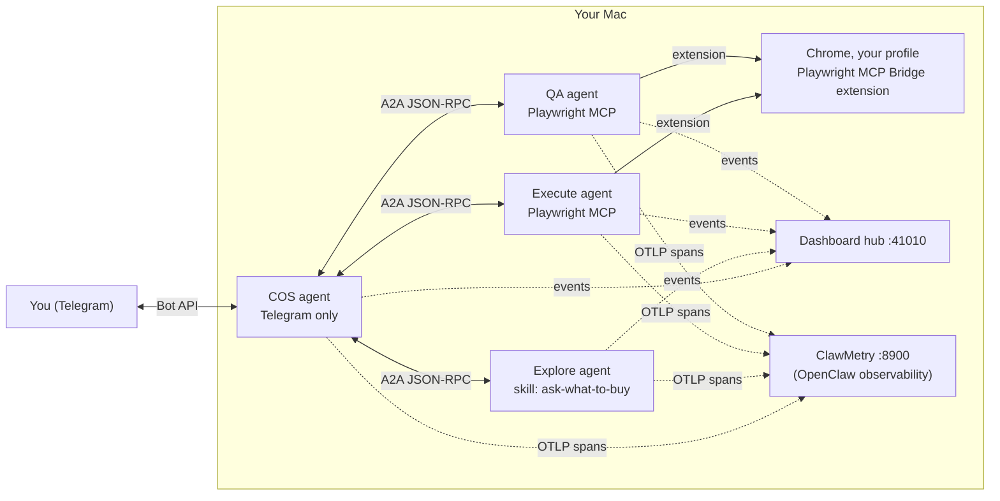
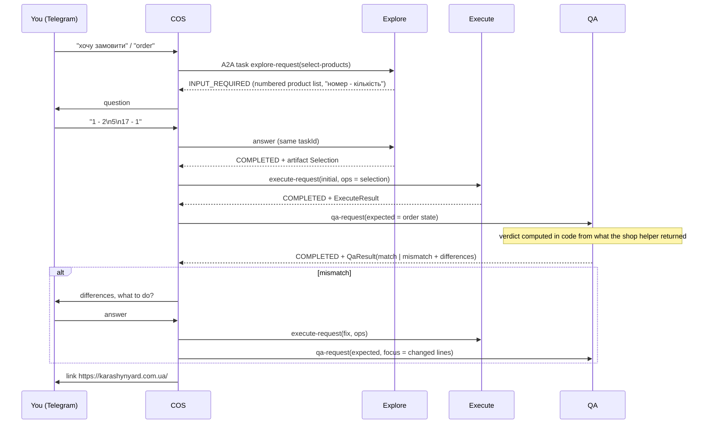

# Architecture

Product Order Orchestrator is a small agent organization: one **Chief of Staff (COS)** that talks to you in
Telegram, and three specialist sub-agents it spawns and delegates to over the **A2A protocol (v1.0)**.
Sub-agents never talk to each other. Every hand-off goes through COS.



## Agents and their only capabilities

| Agent | Process / port | LLM (default) | Tools it can call | Cannot |
|---|---|---|---|---|
| COS | `src/agents/cos/main.ts` (A2A client, no port) | `claude-opus-5-5` | in-process MCP `cos`: Telegram send, delegate/answer/cancel sub-agent tasks, order state | browser, product list |
| Explore | `src/agents/explore/main.ts` :41001 | `claude-sonnet-5-5` | `Skill` (only `ask-what-to-buy`), `mcp__explore__ask_user`, `mcp__explore__update_product_list` | Telegram, browser |
| Execute | `src/agents/execute/main.ts` :41002 | `claude-sonnet-5-5` | Playwright MCP through the extension (own tab, look, wait, page scripts = one shop-helper call), `mcp__agent__ask_user` | Telegram, product list, clicking, typing |
| QA | `src/agents/qa/main.ts` :41003 | `claude-sonnet-5-5` | Playwright MCP through the extension (same, read-only helper calls, clicks only the basket icon), `mcp__agent__ask_user` | Telegram, product list, changing the basket |

Enforcement is in code, not in prompts: every agent runs the Claude Agent SDK with `tools: []` (Explore: `['Skill']`),
`strictMcpConfig`, `permissionMode: 'dontAsk'`, an explicit `allowedTools` list, all built-ins in
`disallowedTools`, and a `PreToolUse` guard (`src/shared/claude.ts`). `ask_user` is **not** Telegram access: it parks
the sub-agent's A2A task in `INPUT_REQUIRED`, and only COS decides how to ask you. The Telegram settings exist only in
COS's own Node process: neither the sub-agents nor any agent's Claude Code process (nor the browser tool servers,
which also never get the API key) receive them.

"COS can spawn sub-agents": `SubagentSupervisor` starts a sub-agent's A2A server process the first time COS needs it
(health-checked through `/.well-known/agent-card.json`). Every delegation is a new A2A task, i.e. a fresh agent run.

## The order flow



"save info - add <product> to product list" → COS delegates `explore-request(update-product-list)`; Explore edits the
product table inside its skill (`agents/explore/.claude/skills/ask-what-to-buy/SKILL.md`), so the next selection
question includes the product.

## A2A contracts (`src/shared/contracts.ts`)

Requests and results travel as A2A **DataParts** next to a human-readable text part. Each payload has a `type`.

| Payload | From → to | Shape |
|---|---|---|
| `explore-request` | COS → Explore | `{action:'select-products', shopId, merge?}` (merge: added to the current order) or `{action:'update-product-list', shopId, add[], remove[]}` |
| `user-question` | any sub-agent → COS (INPUT_REQUIRED status) | `{question, options?}` |
| `selection` | Explore → COS (artifact) | `{shopId, items:[{name, qty, sku?}]}` |
| `product-list-update` | Explore → COS (artifact) | `{shopId, added[], removed[], products[]}` |
| `execute-request` | COS → Execute | `{shopId, mode:'initial'|'fix', ops:[{name, targetQty}]}` — `targetQty` is the absolute quantity, 0 removes |
| `execute-result` | Execute → COS (artifact) | `{shopId, cartUrl, ops:[{name, targetQty, status, actualQty?}], cart[]}` |
| `qa-request` | COS → QA | `{shopId, expected:[{name, qty}], focus:[{name, check:'quantity'|'present'|'absent', expectedQty?}]}` |
| `qa-result` | QA → COS (artifact) | `{verdict:'match'|'mismatch', modalOpened, cart[], differences:[{kind:'missing'|'extra'|'quantity', name, expectedQty, actualQty}], focus[], cartUrl, notes?}` |
| `error` | sub-agent → COS (FAILED status) | `{code, message, hint?}` |

COS keeps the **order state** in code (`src/agents/cos/order-state.ts`): the A2A `contextId` of the order, the
expected basket (from the Selection, plus merge selections, updated by successful fix operations or by you accepting
extra items), the re-checks of the last fix, and pending sub-agent questions (with when they were relayed). Payloads
COS forwards are built from that state, so no JSON is retyped by an LLM. The basket counts as verified only when the
last QA check is current, read the open basket window (`modalOpened`) and nothing differs; only then is the link sent.

Results do not depend on the models' retelling either: the select-products question is rendered in code from the
skill's table and Explore returns table rows; Execute's and QA's results are taken from what the shop helper
returned in the page (captured from the tool results), with the model's report only as a fallback.

COS itself is one long-lived model session. Each user message reaches it with the time it was received (and whether
it waited for the previous turn), the pending questions and the order state. Its budget counts per session: the
session is replaced between turns at 60% of it, and a session cut by the budget or the turn limit is replaced by one
that continues the step (a `<system_event>`) once the cut turn's delegations have finished.

## The shop: karashynyard.com.ua (Tilda)

* The basket is Tilda's T706 cart. It lives only in the browser's `localStorage["tcart"]` (no server cart), expires
  after 2 days, and **merges by adding quantities**. So Execute and QA must drive *your* browser profile, and Execute
  sets absolute quantities (`setQty`) instead of blindly clicking "add".
* Browser connection (`BROWSER_MODE`, `src/browser/connection.ts`): `extension` (default) starts Playwright MCP with
  `--extension --profile-dir-name <CHROME_PROFILE_DIR>`. It opens the Playwright MCP Bridge extension's connect page
  in that Chrome profile, and the extension relays CDP through `chrome.debugger`, so no debugging port is opened.
  `PLAYWRIGHT_MCP_EXTENSION_TOKEN` skips the per-connection approval. `cdp` attaches to `BROWSER_CDP_URL` (the
  `pnpm browser:chrome` profile, the smoke and e2e tests). agent-browser has no extension mode, so it is accepted
  (`EXECUTE_BROWSER_MCP` / `QA_BROWSER_MCP`) only with `cdp`. Before a task starts its browser server, a pre-flight
  check (extension installed in the profile, or the CDP endpoint answers) fails fast with `BROWSER_NOT_CONNECTED`
  and a fix for the user.
* `src/shops/karashynyard/` holds the adapter: allowed origins, checkout endpoints to block, forbidden patterns,
  and an in-page helper (`window.__poo`) that the guard injects into every eval call, plus the Execute/QA playbooks.
* Safety: the order form ("Відправити замовлення") is never touched. Layers, all in code:
  - tool lists per role (`src/browser/mcp.ts`): no typing, key presses, form filling, tab listing/switching,
    `browser_run_code_unsafe` or file upload; only QA has a click tool;
  - page scripts are exactly one call of the shop helper with literal arguments (`src/browser/guard.ts`); QA may
    only call its read methods and click only the basket icon (`src/agents/qa/guard.ts`);
  - guard patterns that deny any tool input mentioning the order form, a submit action or the order endpoints;
    a navigation allow-list; Playwright `--blocked-origins` for the Tilda forms endpoints (the network layer;
    agent-browser rejects domain filters on CDP sessions, so a QA on agent-browser relies on the layers above).
* The user's other tabs: through the extension a session sees only its own tab group, which starts with the
  connect page the extension opened for this run; the agent loads the shop in that tab and closes it as its last
  browser call (then the guard denies every browser tool, since a new call would reconnect and open a tab).
  Over CDP the Playwright guard denies every tool until the run opened its own tab. No run may list, select or close
  tabs; every injected page script first checks that its tab is on the shop; tab titles
  and URLs of other tabs are hidden in tool results (`src/browser/redact.ts`) before the model, the dashboard or a
  log sees them.

## Observability

Every process has one `Telemetry` (`src/observability/telemetry.ts`) that emits:

1. **Dashboard events** to the built-in hub (`src/observability/hub/`, http://127.0.0.1:41010): agent status board,
   A2A message timeline, tool calls with inputs/outputs/durations, errors, Telegram transcript (both sides), tokens
   and cost (from each run's final usage report). COS's events carry the current order's `contextId`. At start the
   hub marks sub-agents that no longer answer as stopped. Like the A2A servers, it listens on loopback only and
   refuses requests addressed to other host names (DNS rebinding).
2. **OpenTelemetry spans** over OTLP/HTTP to **ClawMetry** (http://127.0.0.1:8900), the OpenClaw observability
   dashboard: `invoke_agent <agent>` per A2A task (trace context propagated in A2A message metadata `traceparent`),
   `execute_tool <tool>` per tool call, `chat <model>` per model turn with that turn's GenAI token usage. One trace per
   delegation tree.

## Runtime layout

```
.runtime/
  claude/            CLAUDE_CONFIG_DIR of the agents' Claude Code processes (no transcripts: persistSession off)
  events/            dashboard event log (JSONL per day; older than RUNTIME_RETENTION_DAYS deleted on start)
  logs/              stdout/stderr of spawned sub-agents
  runs/<taskId>/     browser snapshots / screenshots per Execute/QA task (same retention)
  clawmetry-venv/    ClawMetry install (pnpm clawmetry:setup)
```
