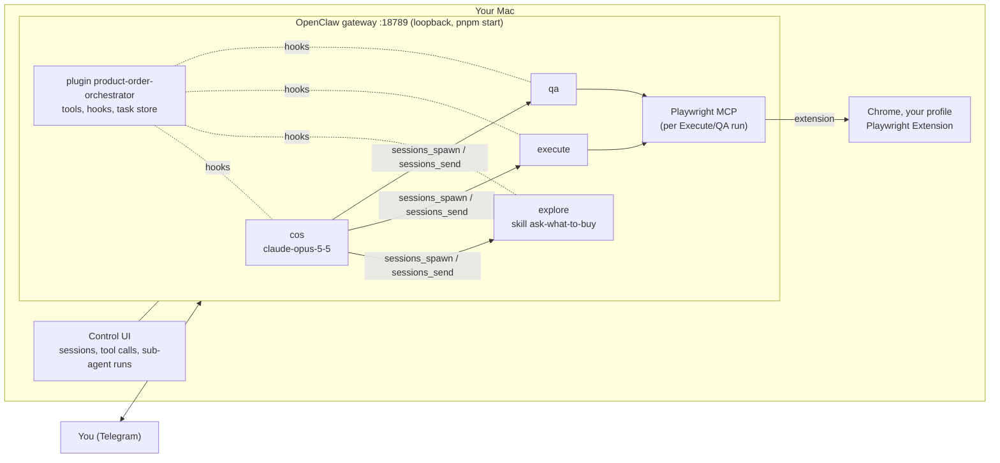

# Architecture

Product Order Orchestrator is a small agent organization inside one [OpenClaw](https://github.com/openclaw/openclaw)
gateway (2026.9.9): a **Chief of Staff (COS)** that talks to you in Telegram, and three specialist agents it starts
as OpenClaw sub-agents. Sub-agents never talk to each other or to you; every hand-off goes through COS. A plugin from
this repo holds every rule in code.



## Agents and their only capabilities

| Agent | Workspace | Model | Tools it can call | Cannot |
|---|---|---|---|---|
| cos | `agents/cos/` | `anthropic/claude-opus-5-5` | `message` (your chat only), `sessions_spawn`, `sessions_yield`, `sessions_send`, `subagents`, `poo_task`, `poo_task_status`, `poo_answer`, `poo_order_state`, `poo_accept_items`, `poo_new_order`, `poo_cancel` | browser, product list, files, shell, web |
| explore | `agents/explore/` | `anthropic/claude-sonnet-5-5` | `read` (its skill file only), `poo_ask_user`, `poo_update_product_list`, `poo_submit_selection` | messaging, browser |
| execute | `agents/execute/` | `anthropic/claude-sonnet-5-5` | `playwright__browser_{tabs,navigate,snapshot,wait_for,evaluate,take_screenshot,console_messages}`, `poo_ask_user`, `poo_submit_execute` | messaging, clicking, typing, sending the order |
| qa | `agents/qa/` | `anthropic/claude-sonnet-5-5` | the Execute browser tools plus `playwright__browser_click` (basket icon only), `poo_ask_user`, `poo_submit_qa` | messaging, changing the basket |

How it is enforced (`src/openclaw/config.ts` generates the config, `src/plugin/` enforces):

- Every agent has an explicit `tools.allow`; the global allow-list stays unset. A child's tools are capped by COS's
  effective tools, so COS's list is the union of all four, and the plugin narrows every COS turn to COS's own tools
  (`before_prompt_build` → `toolsAllow`) and refuses any other call (`before_tool_call`).
- Only COS may spawn (`subagents.allowAgents`, `maxSpawnDepth: 1`); `tools.agentToAgent.enabled: false` and
  `tools.sessions.visibility: "tree"`: COS reaches only its own children. Children never get `message`.
- `tools.codeMode` and `tools.toolSearch` are off, the built-in `browser` plugin is disabled, the skill workshop and
  memory dreaming are off, and `skipBootstrap` keeps OpenClaw's persona files out of the workspaces.
- Telegram is bound to `cos` only, `dmPolicy: "allowlist"` with your id; `messages.visibleReplies: "message_tool"`
  keeps COS's plain text private, so you see only what it sends with `message`. Messages you write while COS works
  queue (`followup`).
- Explore's session never starts the browser server (a deny on `playwright__*`); Execute and QA each start their own
  Playwright MCP process per run.

## The plugin

`src/plugin/` (bundled to `openclaw/plugin/dist/index.js` with esbuild; the SDK is used for types only):

- **Task store** (`store.ts`): replaces the old A2A tasks. A task holds the sub-agent request (built from the order
  state), COS's instruction, its state (`created`, `running`, `input-required`, `answered`, `completed`, `failed`,
  `canceled`), the child session, the questions with `askedAt` / `relayedAt` / `answeredAt` / `deliveredAt`, and the
  result. The order (`src/core/order-state.ts`) and the tasks are one JSON file, rewritten atomically after every
  change, so a gateway restart keeps them. OpenClaw loads the plugin module more than once per process, so the
  runtime is shared through `globalThis`.
- **COS tools** (`tools.ts`, `cos.ts`): `poo_task` builds the request from the order state, so the model never retypes
  JSON or product lists. Every report carries a `next` step.
- **`sessions_spawn`**: COS passes only `{agentId, task: <taskId>}`; the plugin refuses unknown tasks and wrong agents,
  writes the task text (request, COS's instruction, the product question rendered from the skill table, the shop
  playbook, earlier questions and answers when a task continues in a new session) and forces `mode: "run"`,
  `cleanup: "keep"`, `completionTarget: "parent"` (the result reaches COS privately), a label and a time limit.
- **Questions**: a child calls `poo_ask_user` and ends its run. COS sends `message "@relay:<taskId>"`; the plugin puts
  the stored question in its place, word for word. Your answer goes to `poo_answer`, then a blocking `sessions_send` to
  the **same** child session; the plugin writes that message from the stored answer. If the session is gone, the task
  continues in a new session whose text replays the question and answer.
- **Results**: children submit through typed tools; code computes the final payloads with the domain logic
  (`selectionFromRows`, `finalizeExecuteResult` with the captured `PageOps`, `toQaResult` with `PageReads`) and folds
  them into the order at once.
- **Browser** (`before_tool_call` on `playwright__*`): the shop guard (`src/core/browser/guard.ts`) per run, keyed by
  session and run (its own tab, allowed origins, the order-form patterns, page scripts = one helper call), QA's
  read-only guard, and the shop helper injected by rewriting `browser_evaluate`'s `function`. The result middleware
  hides your other tabs (`redact.ts`) and captures what the helper returned.
- **Messages**: COS may send plain text to your chat only; `{{cart_link}}` is filled in, and any message with the basket
  link is refused (and `message_sending` cancelled) until `OrderState.isVerified()`: the last QA check read the basket
  window, nothing changed since, and nothing differs.
- **Context**: every COS turn gets `<order_state>`, `<subagent_tasks>` (state and `next` of each task) and
  `<pending_subagent_questions>` (with `received_at` and `relayed_at`).
- **Lifecycle**: `subagent_spawned` binds the child session to its task, `subagent_ended` settles a run that ended
  without a result, and `/new` (`before_reset`) clears the order and cancels its tasks.

## The order flow

```mermaid
sequenceDiagram
  participant U as You (Telegram)
  participant C as COS
  participant P as Plugin
  participant E as Explore
  participant X as Execute
  participant Q as QA
  U->>C: "хочу замовити"
  C->>P: poo_task explore, sessions_spawn {task}
  P-->>E: task text with the product question
  E->>P: poo_ask_user (question), run ends
  C->>U: message @relay:<task> (the question, verbatim)
  U->>C: "1 - 2 / 5"
  C->>P: poo_answer, sessions_send (same session)
  E->>P: poo_submit_selection (rows) → selection in the order
  C->>U: confirms the selection
  C->>P: poo_task execute (whole expected basket)
  X->>X: own tab, setQty per line (helper), readCart
  X->>X: fillOrderForm() (plugin writes the details), readOrderForm; tab stays open
  X->>P: poo_submit_execute → results and order form check from the page
  C->>P: poo_task qa (expected basket + re-checks)
  Q->>Q: own tab, basket icon, readModal, readCart
  Q->>P: poo_submit_qa → verdict computed in code (basket + Execute's form check)
  alt match, read in the basket window
    C->>U: summary + {{cart_link}} (filled in now)
  else mismatch
    C->>U: the differences, fix or keep?
    U->>C: "прибери зайве"
    C->>P: poo_task execute fix → qa with focused re-checks
  end
```

## Contracts

`src/core/contracts.ts` (zod) defines the payloads: `ExploreRequest`, `Selection`, `ProductListUpdate`,
`ExecuteRequest` (absolute `targetQty` per product), `ExecuteResult`, `QaRequest` (expected basket plus `focus`
re-checks: `quantity`, `present`, `absent`), `QaResult` (verdict, differences, failed checks). The re-checks are
derived in code from the last fix's successful operations, so QA knows exactly what to look at ("quantity is now 2",
"the item appeared", "the item is gone").

## The shop

The basket of karashynyard.com.ua (Tilda) lives in the browser profile's `localStorage`, expires after 2 days and
merges by adding quantities. So Execute and QA drive *your* Chrome profile, and Execute sets absolute quantities
(`setQty`) instead of clicking "add". `src/core/shops/karashynyard/` holds the adapter: allowed origins, checkout
endpoints to block (Playwright `--blocked-origins`), forbidden patterns, the in-page helper `window.__poo` (injected
into every page script) and the Execute/QA playbooks. Another shop is another `ShopAdapter`.

**The order form** (optional, `CHECKOUT_*` in `.env` → the plugin's `checkout` config). It keeps its values only in
the tab where it was filled, and every Execute/QA run has its own tab that other runs cannot see. So Execute fills it
last, with `window.__poo.fillOrderForm()` (no arguments: the guard rewrites the call with the configured name, phone,
delivery option and address), reads it back with `readOrderForm()` and keeps its tab open for the user (the guard
refuses closing it). `PageOps` captures what the page returned and `checkOrderForm` compares it with the configured
details (`orderForm` in the result: `ok`, `mismatch`, or `unverified` when no read-back followed the last basket
change). The QA request carries that check, QA's verdict is a mismatch unless it is `ok`, and `isVerified()` requires
it, so the basket link waits for a correct form. Submitting stays blocked as before.

Playwright MCP (`--extension --profile-dir-name <profile>`) opens the Playwright Extension's connect page in your
profile; with `PLAYWRIGHT_MCP_EXTENSION_TOKEN` the connection is approved automatically. Each run gets its own tab group
and sees only it. `BROWSER_MODE=cdp` (a throwaway or `pnpm browser:chrome` Chrome over `--cdp-endpoint`) is for the
smoke test and the e2e only.

## Observability

The OpenClaw Control UI is the dashboard: COS's chat with every tool-call card, sub-agent runs (view-only, through
`/subagents list|info|log`), Agents, Activity, Usage (tokens, cost) and Logs. Session transcripts, including refused
calls with their reasons, are in OpenClaw's state (`chat.history`).

## Runtime layout

OpenClaw runs from this project (`src/openclaw/local.ts`): the pinned `node_modules/openclaw`, with
`OPENCLAW_STATE_DIR` and `OPENCLAW_CONFIG_PATH` under `.runtime/openclaw/`, and the secrets from `.env` in the process
environment (every `pnpm` script loads it). `pnpm start` builds the plugin, writes the config and runs the gateway in the
foreground; `pnpm openclaw <command>` runs any OpenClaw command against the same state.

```
.env                                    the only secrets: ANTHROPIC_API_KEY, TELEGRAM_BOT_TOKEN, PLAYWRIGHT_MCP_EXTENSION_TOKEN
.runtime/
  openclaw/openclaw.json                generated config (no secrets, only ${VAR} references)
  openclaw/gateway-token                the loopback gateway's token (0600, created on first start)
  openclaw/state/                       sessions, transcripts, the plugin's order and tasks
  playwright/                           browser snapshots and screenshots
```
